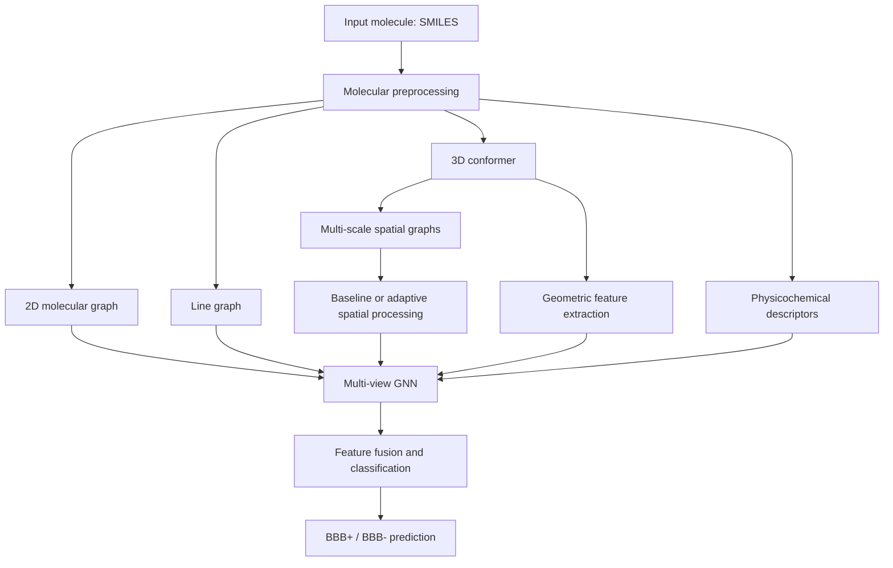

# Adaptive Spatial Edge Selection for Blood–Brain Barrier Permeability Prediction

**A Multi-View Graph Neural Network Framework for Molecular Property Prediction**


## 1. Overview

The blood–brain barrier (BBB) is a selective biological interface that regulates the movement of substances from the bloodstream into the brain. Predicting whether a molecule can cross this barrier is an important problem in drug discovery, medicinal chemistry, and central nervous system drug development.

Traditional molecular prediction methods often rely on molecular descriptors or two-dimensional molecular structures. However, molecular permeability can be influenced by several complementary factors, including chemical connectivity, molecular topology, three-dimensional geometry, and physicochemical properties.

This project investigates a **multi-view graph neural network (GNN) framework for BBB permeability prediction**, with a proposed adaptive spatial-edge selection mechanism intended to reduce unnecessary spatial graph connections while preserving important molecular relationships.

The framework compares two model configurations:

- **Baseline model:** Integrates multiple molecular graph representations, including multi-scale spatial graphs.
- **Adaptive model:** Introduces a learnable spatial-edge scoring and selection mechanism with a configurable edge budget and optional chemical-bond preservation.

The objective is to investigate whether adaptive spatial graph construction can maintain predictive performance while reducing the number of spatial edges processed by the model.

> **Research status:** This repository contains a research prototype and an experimental comparison framework. Claims of improved accuracy, computational efficiency, or research novelty require systematic evaluation and comparison with relevant published methods.

## 2. Research Motivation

Graph neural networks represent molecules as graphs, where atoms correspond to nodes and chemical bonds correspond to edges. Although this representation captures chemical connectivity, it may not fully represent spatial relationships between atoms.

Three-dimensional molecular representations introduce additional information, but spatial graph construction can produce a large number of candidate edges. Processing all candidate edges may increase computational cost, especially as molecular size increases.

This project investigates the following research question:

**Can learnable adaptive spatial-edge selection improve the efficiency of a multi-view molecular GNN while retaining competitive BBB permeability prediction performance?**

The investigation focuses on three aspects:

1. **Multi-view molecular representation:** Combining complementary structural, topological, spatial, and physicochemical information.
2. **Adaptive spatial-edge selection:** Learning which candidate spatial relationships should be retained for downstream prediction.
3. **Empirical evaluation:** Comparing predictive performance, edge-retention statistics, and computational costs against a baseline model.

## 3. Research Objectives

- Develop a multi-view graph learning pipeline for binary BBB permeability classification.
- Represent molecular structure using molecular graphs, line graphs, and multi-scale spatial graphs.
- Integrate molecular descriptors and geometric features into a graph-based prediction model.
- Implement learnable scoring of candidate spatial edges.
- Investigate edge-budget constraints and optional preservation of chemical bonds.
- Compare baseline and adaptive model configurations under controlled experimental conditions.
- Evaluate performance using appropriate classification metrics and computational measurements.
- Identify limitations and opportunities for further optimization.

## 4. Proposed Methodology

### 4.1 Overall architecture

The current pipeline follows this general sequence:



The diagram describes the intended information flow; exact operations are defined by the model implementation.

### 4.2 Molecular graph representation

The molecular graph represents atoms as nodes and chemical bonds as directed edges.

The implementation uses atom-level features that include:

- Atomic number
- Atom degree
- Formal charge
- Aromaticity

This representation captures the fundamental chemical connectivity of the molecule.

### 4.3 Line graph representation

The line graph provides a complementary representation of molecular topology. In this representation, nodes correspond to bonds in the original molecular graph, and connections represent relationships between bonds that share an atom.

This view enables the model to learn bond-level and local topological patterns alongside atom-level features.

### 4.4 Three-dimensional multi-scale spatial graphs

The framework generates spatial graph representations from three-dimensional molecular conformers.

The current configuration uses distance cutoffs of:

- 2 Å
- 3 Å
- 4 Å
- 5 Å

These graphs represent spatial relationships at different distance scales. Combining multiple scales allows the model to investigate both short-range and broader local molecular interactions.

The conformer-generation and graph-construction procedures are implemented using RDKit and the project's graph utilities.

### 4.5 Physicochemical descriptors

The model uses seven molecular descriptors:

| Feature | Purpose |
|---|---|
| Molecular weight | Represents molecular size |
| LogP | Approximates lipophilicity |
| TPSA | Represents topological polar surface area |
| Hydrogen-bond donors | Measures donor capacity |
| Hydrogen-bond acceptors | Measures acceptor capacity |
| Rotatable bonds | Represents molecular flexibility |
| Ring count | Describes ring-related structural properties |

These descriptors provide complementary information that may not be captured directly by graph topology.

### 4.6 Geometric features

The framework also extracts a 24-dimensional geometric feature representation from molecular conformers.

These features are integrated with the graph-based and descriptor-based representations. Their exact definitions should be interpreted from the implementation in `src/graphs/geometric_features.py`.

### 4.7 Baseline model

The baseline model combines the available molecular views, including:

- Two-dimensional molecular graph
- Line graph
- Multi-scale spatial graphs
- Physicochemical descriptors
- Geometric features

The model includes feature-fusion and classification components to produce a binary BBB permeability prediction.

The baseline serves as the reference configuration for evaluating the proposed adaptive spatial-edge selection mechanism.

### 4.8 Proposed adaptive spatial-edge selection

The adaptive model introduces a learnable spatial-edge selector.

Rather than treating all candidate spatial edges equally, the selector assigns scores to candidate edges and uses an edge-budget constraint to determine which edges are retained.

The current implementation includes:

- Learnable spatial-edge scoring
- Configurable edge-budget ratio
- Optional preservation of chemical bonds
- Edge-retention and sparsity statistics
- A regularization mechanism associated with edge selection

The adaptive model is intended to reduce unnecessary spatial connections while retaining relationships useful for molecular prediction.

**Important implementation distinction:** The current edge-budget ratio is configured through a parameter. The edge selector learns edge scores, but the budget itself should not be described as a learned or predicted adaptive threshold unless that functionality is explicitly implemented and validated.

The current implementation also uses a candidate spatial graph from the multi-scale graph construction pipeline. The precise behavior of edge filtering and bond preservation is determined by the model and selector code.

### 4.9 Research hypothesis

The central hypothesis is that selective processing of spatial relationships may reduce graph-processing overhead without substantially degrading predictive performance.

This hypothesis will be investigated through comparisons of:

- ROC-AUC and PR-AUC
- Precision, recall, and F1-score
- Number of candidate and retained spatial edges
- Edge sparsity
- End-to-end inference latency
- Peak memory usage

The hypothesis should be considered supported only if experiments demonstrate consistent results under appropriate evaluation conditions.

## 5. Dataset and Preprocessing

The project includes data-processing utilities for the BBBP task and a ChEMBL-related preprocessing workflow.

The exact dataset composition, source, label definitions, and number of valid molecules should be documented from the data files and preprocessing logs used for each experiment.

The preprocessing pipeline may include:

1. Loading molecular structures and labels.
2. Validating molecular SMILES.
3. Cleaning invalid or incomplete records.
4. Generating three-dimensional conformers.
5. Computing molecular descriptors.
6. Constructing molecular, line, and spatial graphs.
7. Extracting geometric features.
8. Preparing aligned model inputs.

All molecular representations must remain aligned with the corresponding molecule and label. Training-set normalization statistics should be applied consistently during validation, testing, and inference.

### Data leakage prevention

For reliable evaluation:

- Fit normalization statistics using training data only.
- Keep validation and test data separate from model fitting.
- Avoid selecting hyperparameters using test-set results.
- Use scaffold-based splitting when evaluating generalization to structurally distinct molecules.
- Check label distributions in every split.
- Document the origin and inclusion criteria of all datasets.

The project supports scaffold and random evaluation splits. Results from these two settings should be reported separately because they measure different generalization conditions.

## 6. Technology Stack

| Technology | Role |
|---|---|
| Python | Implementation language |
| PyTorch | Neural network training and inference |
| PyTorch Geometric | Graph representation and graph neural network operations |
| RDKit | Molecular parsing, descriptors, and conformer generation |
| NumPy | Numerical operations |
| pandas | Dataset processing and experimental result handling |

Refer to `requirements.txt` for the project's declared dependencies.

## 7. Repository Structure

The principal project components are organized as follows:

```text
bbbp-multi-view-gnn-with-adaptive-spatial-edge-selection/
├── main.py
├── requirements.txt
├── README.md
├── config/
├── data/
├── processed/
├── src/
│   ├── graphs/
│   │   ├── molecular_graph.py
│   │   ├── line_graph.py
│   │   ├── adaptive_distance_graph.py
│   │   ├── geometric_features.py
│   │   └── graph_utils.py
│   ├── models/
│   │   └── bbbp_model.py
│   ├── preprocessing/
│   ├── training/
│   ├── evaluation/
│   ├── pretraining/
│   └── predict.py
├── utils/
├── checkpoints/
└── results/
```

Some directories may contain additional files depending on the current project version.

### Important modules

- `main.py` — Command-line entry point for project workflows.
- `src/models/bbbp_model.py` — Multi-view model and adaptive spatial-edge selection integration.
- `src/graphs/molecular_graph.py` — Molecular graph construction.
- `src/graphs/line_graph.py` — Line graph construction.
- `src/graphs/adaptive_distance_graph.py` — Multi-scale spatial graph construction.
- `src/graphs/geometric_features.py` — Geometric feature extraction.
- `src/graphs/graph_utils.py` — Graph-building pipeline.
- `src/predict.py` — Single-molecule inference.
- `requirements.txt` — Python dependencies.
- `checkpoints/` — Trained model checkpoints, when included.
- `results/` — Experimental outputs, when generated.

## 8. Installation

### Prerequisites

- Windows, Linux, or macOS
- Python compatible with the dependencies in `requirements.txt`
- Git
- A compatible PyTorch and PyTorch Geometric installation

GPU execution is optional if the installed dependencies support CPU inference.

### Clone the repository

```bash
git clone https://github.com/YOUR-USERNAME/YOUR-REPOSITORY.git
cd YOUR-REPOSITORY
```

Replace the URL with the actual GitHub repository URL.

### Create a virtual environment

On Windows PowerShell:

```powershell
py -3.11 -m venv .venv
.\.venv\Scripts\Activate.ps1
```

If PowerShell blocks environment activation, use an appropriate local execution-policy setting or run the environment's Python executable directly.

### Install dependencies

```powershell
python -m pip install --upgrade pip
pip install -r requirements.txt
```

**Environment note:** PyTorch and PyTorch Geometric installations can depend on the Python version, operating system, and CPU/CUDA configuration. If dependency installation fails, consult the official installation instructions for those libraries and select compatible versions.

## 9. Running the Project

The following commands correspond to the command-line interface. Check `python main.py --help` and each command's help output for the options supported by your current version.

### 9.1 Verify the pipeline

```powershell
python main.py verify
```

This checks configured data alignment and model-related verification routines.

### 9.2 Preprocess the dataset

Inspect the available preprocessing stages:

```powershell
python main.py preprocess --help
```

Run the preprocessing workflow using the stages and input data expected by your local configuration. Some workflows require cleaned data and conformer files before graph construction.

### 9.3 Train the baseline model

Inspect supported training options:

```powershell
python main.py train --help
```

An example configuration is:

```powershell
python main.py train --split scaffold --epochs 3 --model-type baseline
```

Use the actual supported option values shown by your command-line help. Three epochs are shown only as a short smoke-test configuration, not as a recommended final research experiment.

### 9.4 Train the adaptive model

```powershell
python main.py train --help
```

An example configuration is:

```powershell
python main.py train --split scaffold --epochs 3 --model-type adaptive --edge-budget 0.5
```

Confirm the accepted `--model-type` values in your implementation before running this command.

The edge-budget parameter controls the configured selection budget; it should not be interpreted as an automatically learned budget.

### 9.5 Evaluate a trained model

```powershell
python main.py evaluate --help
```

An example is:

```powershell
python main.py evaluate --split scaffold
```

Specify the checkpoint and threshold explicitly when required for reproducible evaluation.

### 9.6 Compare baseline and adaptive models

```powershell
python main.py compare --help
```

An example comparison command is:

```powershell
python main.py compare --split scaffold --epochs 3 --edge-budget 0.5
```

This command is intended to run the project's baseline-versus-adaptive comparison workflow. Validate the resulting test metrics before interpreting them.

### 9.7 Predict BBB permeability for a molecule

The repository includes a command for single-molecule inference using an existing trained checkpoint.

Example using the adaptive model:

```powershell
python main.py predict --smiles "CCO" --model adaptive
```

Example using the baseline model:

```powershell
python main.py predict --smiles "CCO" --model baseline
```

The input is a SMILES string. The model produces a predicted BBB class and associated model probability.

The current label convention is:

- `BBB+` — positive class, label 1.
- `BBB-` — negative class, label 0.

The prediction depends on the trained checkpoint, preprocessing, feature normalization, and decision threshold. The output probability is a model score and should not automatically be interpreted as a calibrated probability of biological permeability.

For inference to work, the required checkpoint files must exist at the expected paths, or a valid checkpoint path must be supplied.

### 9.8 Additional research commands

The CLI also includes workflows for other experiments:

```powershell
python main.py explain --help
python main.py ablation --help
python main.py multiseed --help
python main.py pretrain --help
python main.py preprocess-chembl --help
```

Consult each command's help output before execution.

## 10. Experimental Evaluation

A research comparison should separate predictive quality from computational efficiency.

### Predictive metrics

| Metric | Purpose |
|---|---|
| ROC-AUC | Measures ranking performance across classification thresholds |
| PR-AUC | Measures the precision-recall trade-off, particularly relevant for imbalanced datasets |
| Precision | Measures the proportion of predicted positives that are true positives |
| Recall | Measures the proportion of actual positives detected |
| F1-score | Balances precision and recall |
| Specificity | Measures the proportion of negatives correctly identified |

For a valid ROC-AUC calculation, the evaluation set must contain both classes. Undefined metrics must be investigated rather than reported as successful performance.

### Computational metrics

| Metric | Purpose |
|---|---|
| Candidate spatial edges | Number of edges available before selection |
| Retained spatial edges | Number of edges retained by the selector |
| Edge sparsity | Fraction of candidate edges removed |
| Edge-selection latency | Time associated with the selector operation |
| End-to-end inference latency | Time required for the complete prediction pipeline |
| Peak memory usage | Memory consumed during the measured workload |

A reduction in edge count alone does not prove a reduction in end-to-end latency. Selection itself has a computational cost, and the result depends on molecular size, batching, hardware, and implementation details.

### Experimental controls

A defensible comparison should use:

- Identical data splits for both models.
- Identical training and validation protocols.
- Consistent feature normalization.
- Clearly documented hyperparameters.
- Multiple random seeds where feasible.
- Appropriate class-distribution checks.
- Repeated latency measurements under controlled conditions.
- Means and variability estimates for key metrics.

For a fair baseline comparison, report both predictive quality and computational cost rather than selecting only the metric that favors one model.

## 11. Results and Reporting

Experimental results should be generated from verified runs and reported without fabricated or assumed values.

Recommended results table:

| Metric | Baseline | Adaptive | Difference |
|---|---:|---:|---:|
| ROC-AUC | To be measured | To be measured | To be calculated |
| PR-AUC | To be measured | To be measured | To be calculated |
| Precision | To be measured | To be measured | To be calculated |
| Recall | To be measured | To be measured | To be calculated |
| F1-score | To be measured | To be measured | To be calculated |
| Retained spatial edges | To be measured | To be measured | To be calculated |
| End-to-end latency | To be measured | To be measured | To be calculated |
| Peak memory usage | To be measured | To be measured | To be calculated |

Replace these placeholders with verified measurements before using this table in a final report or publication.

If an evaluation produces a perfect-looking score alongside an undefined ROC-AUC, inspect the test-set labels and metric implementation before drawing conclusions.

## 12. Current Scope and Limitations

The project is an experimental framework rather than a clinically validated BBB permeability predictor.

Important limitations include:

1. **Dataset limitations:** Prediction quality depends on dataset size, label quality, chemical diversity, and experimental consistency.
2. **Conformer dependence:** Three-dimensional representations depend on the generated conformer and its quality.
3. **Edge-budget configuration:** The current edge budget is configured by the user rather than predicted automatically.
4. **Computational overhead:** Edge scoring and selection may introduce overhead that offsets savings from reducing graph connections.
5. **Evaluation reliability:** Metrics must be checked for class imbalance, split validity, leakage, and threshold-selection effects.
6. **Generalization:** Performance on one benchmark does not guarantee performance on unseen chemical scaffolds or real-world compounds.
7. **Interpretability:** High edge scores do not automatically establish a causal or experimentally meaningful molecular interaction.
8. **Biological validation:** Computational predictions require appropriate experimental evidence before being used for biological or drug-development decisions.

## 13. Proposed Future Work

Potential extensions include:

- Learning the edge budget from molecular structure or estimated graph complexity.
- Investigating adaptive budget policies based on candidate-edge density.
- Comparing fixed-budget selection with learned budget prediction.
- Improving the selector's computational efficiency.
- Evaluating performance across several edge-budget settings.
- Adding repeated-seed experiments and uncertainty estimates.
- Conducting ablation studies to isolate the contributions of each molecular view.
- Testing scaffold generalization and external datasets.
- Studying edge-selection interpretability.
- Exploring applicability to other molecular property prediction tasks.

These are potential directions, not claims that the corresponding functionality is already implemented.

## 14. Reproducibility Checklist

Before using results in a report or paper, document:

- Dataset source, version, and filtering procedure.
- Training, validation, and test split definitions.
- Random seeds.
- Model architecture and configuration.
- Edge-budget ratio and bond-preservation setting.
- Training duration and checkpoint selection criteria.
- Classification threshold and how it was selected.
- Software versions and hardware configuration.
- Metric definitions and evaluation code.
- Inference latency measurement procedure.
- Limitations and failed or inconclusive experiments.

Store the final experimental configuration and results alongside the code version that produced them.

## 15. Citation and Related Work

This project should be evaluated against relevant literature in:

- BBB permeability prediction.
- Molecular graph neural networks.
- Multi-view molecular representation learning.
- Three-dimensional molecular graph construction.
- Sparse graph learning and adaptive edge selection.
- Computationally efficient molecular property prediction.

A relevant starting point for the project's broader motivation is:

**U2CMigration: User-Unaware Container Migration with Predictive Analysis of Memory Dirty Pages.** *Journal of Computer Science and Technology* (2025).

Article: https://link.springer.com/article/10.1007/s11390-025-4583-0

This paper concerns memory dirty-page prediction for container migration. It is from a different application domain and should not be presented as direct evidence for BBB permeability prediction or as proof that the molecular edge-selection mechanism is novel.

Before publication, identify and cite the most closely related molecular graph sparsification and adaptive edge-selection papers, and clearly distinguish their contributions from this project's implementation.

## 16. Responsible Use

This software is intended for academic research and experimentation. Its outputs are computational predictions, not medical advice or experimental confirmation of BBB permeability.

Users should independently validate predictions and follow the licensing requirements of the datasets, dependencies, and any third-party resources they use.

## 17. Acknowledgements

This project builds on open-source scientific computing and cheminformatics tools, including PyTorch, PyTorch Geometric, and RDKit.

Their respective licenses and citation requirements should be followed when distributing or publishing work based on this software.

## 18. Author and Project Information

- **Project:** Adaptive Spatial Edge Selection for BBB Permeability Prediction
- **Domain:** Computational drug discovery, graph machine learning, cheminformatics
- **Project type:** Research and implementation prototype
- **Repository:** Add the GitHub repository URL
- **Author:** Add your preferred name
- **Institution:** Add your institution, if appropriate

---

**Research objective:** To investigate whether learnable spatial-edge selection can provide a useful accuracy-efficiency trade-off for multi-view molecular graph learning, supported by reproducible experiments and fair baseline comparisons.
